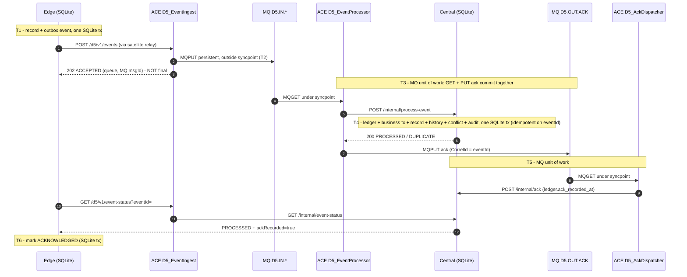

# D5 – Data Flow, Acknowledgement and Transaction Boundaries

## Event model (edge → central)

```json
{
  "eventId": "9e8b09da-fd4c-48ed-88c5-de2f02bcb782",   // UUID v4, generated onboard; idempotency key
  "eventType": "RECORD_CREATED | RECORD_UPDATED",
  "recordId": "MNT-2001", "recordType": "PR|GRN|MAINTENANCE|EMERGENCY_MAINTENANCE",
  "vesselId": "VESSEL-01", "sourceSystem": "VESSEL_AMOS",
  "priority": "CRITICAL|NORMAL|LOW",
  "sequenceNumber": 12,          // per-vessel monotonic outbox sequence
  "version": 2,                  // record version after this change
  "baseVersion": 1,              // RECORD_UPDATED only
  "baseSnapshot": { ... },       // RECORD_UPDATED only: record as it was before the change (three-way merge base)
  "changedFields": { ... },      // RECORD_UPDATED only
  "createdAt": "...", "updatedAt": "...", "updatedBy": "chief-engineer@vessel-01", "recordCreatedAt": "...",
  "payload": { ... }             // full record after the change
}
```
ACE adds an `integration` block: receivedAt, integrationServer, queue, mqPriority and via. The original timestamps and eventId are never changed.

## Delivery states on the edge

| State | Meaning | Next |
|---|---|---|
| PENDING | Committed onboard with the record (same transaction) | Dispatcher sends when it is the highest-priority event |
| SENDING | HTTP request in progress | After a crash it reverts to PENDING (outcome unknown, so it is re-sent) |
| ACCEPTED | ACE returned **202**: the message is persistent on `D5.IN.<priority>` | Poll `/d5/v1/event-status` |
| ACKNOWLEDGED | Central ledger = PROCESSED **and** the business ack from D5.OUT.ACK is recorded | Final. The row is kept as history |
| FAILED | Validation rejection (HTTP 400 from ACE or 422 from central) | Kept. It can be replayed after correction |

An event stuck in ACCEPTED with status UNKNOWN past `ackTimeoutSec` (default 20 s) is **re-sent with the same eventId**.

## Transaction boundaries



| Boundary | Resources | What it guarantees |
|---|---|---|
| T1 | Vessel SQLite | A record change can never exist without its outbound event |
| T2 | MQ (persistent, no syncpoint) | 202 is only returned after the message is on disk in D5QM |
| T3 | MQ (D5.IN.* get + D5.OUT.ACK put) | The ack exists only if the get is committed. On a failure the message returns to the queue |
| T4 | Central SQLite | All business effects of one event are atomic. The eventId ledger blocks double processing |
| T5 | MQ get + central SQLite | The ack is recorded before the message leaves D5.OUT.ACK |
| T6 | Vessel SQLite | The event is marked done only after central confirmation |

**T3 and T4 are not XA-coordinated.** The central commit (T4) happens before the MQ commit (T3). If ACE fails between the two, MQ redelivers the event. The ledger detects it as a DUPLICATE, returns the original result, and the ack is produced. That is the purpose of idempotent processing, and it is covered by tests D5-04 and R-02.

## Failure handling

| Failure | Behaviour | Tested by |
|---|---|---|
| Satellite down | Relay closes the connection. Dispatcher backs off exponentially (2 s × 2^n, max 30 s, ±20 % jitter). The management probe resets the back-off when the link returns | D5-02/03, R-03 |
| Edge crash | SQLite WAL with synchronous=FULL. A SENDING event reverts to PENDING on start. systemd restarts the agent | R-01 |
| ACE flow not deployed or redeploying (404) | Treated as transient and retried | unit test |
| Invalid event | ACE returns 400 and parks the event on D5.ERROR. The edge marks it FAILED (kept, not deleted) | R-04 |
| Central down | ACE still accepts (202). Processor rolls back, MQ redelivers, after BOTHRESH(3) the message is moved to D5.ERROR. The edge stays unacknowledged and re-sends after ackTimeout | R-02 |
| Central rejects the business content (422) | Parked on D5.ERROR with a rejection ack. The ledger shows REJECTED and the edge marks it FAILED | unit test |
| Ack consumer cannot reach central | D5.OUT.ACK get rolls back. After BOTHRESH(10) it goes to D5.ERROR. The edge re-sends after ackTimeout and the duplicate produces a new ack | design |
| Duplicate delivery | Ledger hit: received_count+1 and a duplicate_log row. No business change | D5-04 |

## Downlink (office → vessel)
Office edits, merge results and conflict resolutions are written to `downlink_feed` in the same central transaction as the change. The vessel pulls the feed through its relay, in order, from a persistent cursor. An item for a record that still has an unacknowledged local change is deferred until that change is acknowledged. This keeps per-record order.
