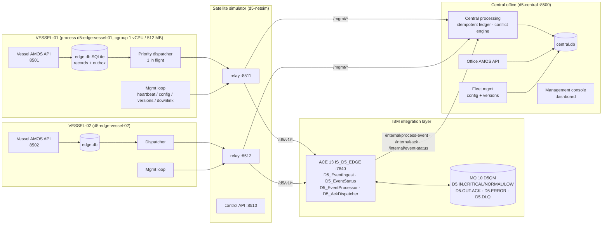

# D5 – Solution Architecture

## Purpose
Vessels keep working through satellite outages. When connectivity returns, IBM ACE and IBM MQ synchronise their operational records with the central office. Critical transactions go first. Delivery is at-least-once, and processing is idempotent and conflict-aware.

Everything runs on the single POC server. Vessels, office and the satellite link are separate processes. Each vessel has its own SQLite file and its own simulated link.

## Component view

## Responsibilities

| Component | Responsibility | Technology |
|---|---|---|
| Vessel AMOS (edge API) | Create and update PR, GRN, Maintenance and Emergency Maintenance records onboard, online or offline | Python 3.9 stdlib HTTP |
| Edge store | The record and its outbound event commit in **one** SQLite transaction (transactional outbox). Rows are never deleted before acknowledgement. Tracks attempts, sync sessions, config and versions | SQLite 3.34, WAL, `synchronous=FULL` |
| Priority dispatcher | One event in flight per vessel. Strict CRITICAL > NORMAL > LOW order, FIFO within a priority, and per-record causal order. Exponential back-off. Waits for the **business** acknowledgement | Python thread |
| Management loop | Sends heartbeats and metrics. Pulls configuration (validated) and agent versions (checksum, staged, health check, rollback). Pulls office changes (downlink) | Python thread |
| Satellite simulator | Per-vessel HTTP relay. When DISCONNECTED it closes the TCP connection, so nothing is forwarded. Supports latency, jitter, bandwidth, loss and intermittent cycling | Python stdlib |
| IBM ACE `D5_EventIngest` | REST endpoint for the edge. Validates the event, maps priority to queue and MQMD priority, sets CorrelId = eventId, and puts a **persistent** message. Returns 202, which is not a business ack | ACE 13.0.9.0, ESQL |
| IBM MQ D5QM | Durable buffer between ingest and processing. Separate queues per priority. Backout to D5.ERROR | MQ 10.0.1.0 CD |
| IBM ACE `D5_EventProcessor` | MQ get, central call and ack put in one MQ unit of work. 4xx parks the event and sends a rejection ack; 5xx rolls back | ACE MQInput (syncpoint) |
| IBM ACE `D5_AckDispatcher` | Consumes D5.OUT.ACK and records the business ack in the central ledger | ACE MQInput (syncpoint) |
| IBM ACE `D5_EventStatus` | Status query used by the edge to confirm business processing | ACE HTTPInput / HTTPRequest |
| Central processing | Event ledger keyed by eventId (idempotency), three-way merge, field ownership policy, conflict records, audit log | Python + SQLite |
| Office AMOS | Office-side record maintenance. Changes are queued per vessel in a downlink feed | Python + SQLite |
| Fleet management | Configuration versions, deployments per vessel or group, agent packages with SHA-256, rollback | Python + SQLite |
| Management console | Nine-page dashboard showing live state. It contains no hardcoded counters | HTML5, CSS, vanilla JS |

## Key design decisions
1. **ACE and MQ sit on the data path.** Every business event passes ACE validation and a persistent MQ hop before central processing. Every business acknowledgement passes through D5.OUT.ACK. The edge cannot complete an event without both.
2. **HTTP 202 ≠ done.** The edge marks an event ACKNOWLEDGED only when the central ledger reports `PROCESSED` **and** the ack from D5.OUT.ACK has been recorded. See [data-flow.md](data-flow.md).
3. **At-least-once transport plus idempotent processing.** Re-sends (ack timeout, replay, crash recovery) are expected. The ledger guarantees a single business transaction per eventId. Exactly-once delivery is **not** claimed.
4. **Strict priority per vessel, not globally.** Each vessel has one in-flight event. CRITICAL goes before NORMAL before LOW, FIFO inside a priority. Separate vessels drain concurrently and independently. MQ also carries priority (separate queues and MQMD.Priority 9/5/1), but the ordering guarantee comes from the edge dispatcher.
5. **No last-write-wins.** Conflicts are resolved field by field: one-sided changes merge automatically, conflicting fields follow an ownership rule, and critical fields go to manual review. See [conflict-resolution.md](conflict-resolution.md).
6. **Management plane over the same link.** Configuration, versions and office changes reach a vessel only when its link is up. Nothing received is executed as a command.
7. **Isolation.** D5 uses its own queue manager (D5QM), its own standalone integration server (IS_D5_EDGE, admin 7614, HTTP 7840), its own ports (8500-8512) and its own workspace. Existing QMs, nodes and servers are not touched.

## Deviations from the brief (and why)
| Brief | Implemented | Reason |
|---|---|---|
| FastAPI | Python stdlib `http.server` | No pip, FastAPI or compiler on the server. The user chose stdlib to avoid package installs |
| Workspace `~/ZMI-ADNOC-POC` | `/home/aceadmin/ZMI-ADNOC-POC/D5-Edge-Demo` | That is where the existing POC workspace actually lives, and ACE runs as aceadmin |
| IS under an existing node | Standalone IS_D5_EDGE | Same pattern as the existing D2/D4 servers, and fully isolated from nodes TEST/TEST2 (approved) |
| Containers / namespaces | systemd transient units, cgroup v2 limits per edge | Podman has no images. Transient units give real CPU and memory limits without changing OS configuration |
| Edge → ACE for management | Management plane goes relay → central directly | Keeps ACE on the business data path. It could be moved behind ACE in a later phase |
